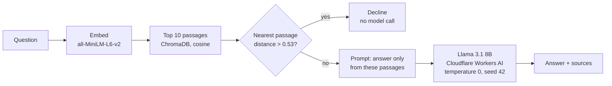

# Ask the documents: a RAG assistant that says when it doesn't know

A retrieval-augmented assistant over 22 openly licensed NLP documents (Wikipedia and
*Dive into Deep Learning*). It answers from the documents, shows the passages it used,
and declines when they don't contain the answer, either before calling the model or
because the model judged the passages insufficient.

**Live demo:** https://rag-assistant-demo.streamlit.app (if it has been idle for 12 hours, click "Yes, get this app back up!" and wait about a minute)

It's the hosted version of my final-year project, a
[local AI orchestration system](https://github.com/MrMomoLegend/ai-orchestrator/tree/e90dc2e)
(University of London BSc Computer Science, 2026). The retrieval pipeline, threshold and
prompt are carried over unchanged. The local Llama 3.1 8B is replaced by the same model on
Cloudflare Workers AI, and the React UI by Streamlit.

## Try it in 30 seconds

1. Open the demo. If it's been idle for 12 hours it sleeps: click **"Yes, get this app back up!"**
   and give it about a minute while it rebuilds the index.
2. Leave the mode on **Compare** and click **"What word error rate does OpenAI's Whisper model
   achieve on LibriSpeech?"**. On the left, the model alone invents a confident figure. On the
   right, with the documents, it declines, because the corpus doesn't say.
3. Click **"Which researchers is the CYK algorithm named after?"**: the model alone names the wrong
   people; with the documents it gives Cocke, Younger and Kasami, with the passage shown.
4. Click **"What is the capital of Brazil?"**: declined in about 10 ms without calling the model,
   because no passage is close enough.

## How it works



- **Corpus:** 22 documents, split into 1,551 chunks of 500 characters with 50 overlap. The index
  is built in memory at startup (about 50 s on a cold start). No index files are stored in the repo.
- **Gate:** if even the closest passage is more than 0.53 cosine distance away, the app declines
  without spending a model call. The threshold was fixed in the FYP on a separate corpus and was
  never retuned for this demo.
- **Prompt:** the model is told to answer only from the passages and to say "The provided
  documents do not contain this information." otherwise.
- **Modes:** *Compare* (model alone vs. with documents, side by side), *With the documents*, and
  *Model alone*. Every answer shows its sources, distances, tokens and timings.

## Results

Measured on the FYP's 30 evaluation questions (15 answerable, 12 out-of-corpus, 3 related but
not answerable from the documents). Full method and caveats are in [PARITY.md](PARITY.md).

| | Model alone | With the documents |
|---|---|---|
| Unanswerable questions answered anyway | 15 / 15 | **0 / 15** (12 declined by the gate, 3 by the model) |
| Answerable questions correct (13 paired) | | **12 / 13** |
| Median response time, model called | 8.3 s | **1.3 s** (gate declines: 0.01 s) |

The hosted demo reproduces the FYP's results. Retrieval distances match on all 30 questions,
no gate decision changes, and accuracy is the same 12 / 13. Answers are shorter with the
documents, which is most of why they're faster.

## Limits

- It only knows the 22 documents. Anything else gets declined, which is the point.
- The gate checks *closeness*, not *coverage*. A question can pass the gate when the answer isn't
  in the documents, and then the model has to decline (it did for all 3 such test questions).
- Wrong retrieval gives a wrong answer: asked for Word2Vec's two architectures, it retrieves a
  Doc2Vec passage and answers PV-DM / PV-DBOW instead of CBOW / skip-gram.
- The outcome label is a keyword check. An answer that ends with a disclaimer ("…the documents
  do not contain the formula for X") can be labelled as declined although it answered.
- Hosted inference isn't bit-for-bit repeatable: 28 of 30 answers were identical across two
  runs with the same seed.
- Free tier: about 10,000 model "neurons" a day. If they run out, the app says so. They reset
  at 00:00 UTC.

## Run it locally

Python 3.12. You need a free Cloudflare account ID and a Workers AI API token.

```bash
git clone https://github.com/MrMomoLegend/rag-assistant-demo.git
cd rag-assistant-demo
python -m venv venv && source venv/bin/activate      # Windows: venv\Scripts\Activate.ps1
pip install -r requirements-dev.txt
cp .env.example .env                                 # add LLM_BASE_URL and LLM_API_KEY
pytest                                               # no network or keys needed
streamlit run app.py
python scripts/parity_check.py --retrieval-only      # free: checks retrieval against the FYP
```

## Repository

- `rag/`: pipeline (chunking, index, gate, prompt, model client, outcome classifier)
- `app.py`: Streamlit interface
- `scripts/parity_check.py`, `eval/`, `results/`, `PARITY.md`: the comparison with the FYP
- `tests/`: unit tests, including "a far question is declined without calling the model"
- `corpus/`: the 22 documents and their licences

## Licence

Code: MIT (see `LICENSE`). Documents in `corpus/`: CC BY-SA 4.0, see `corpus/README.md`.

Mokith Maheshkumar · [LinkedIn](https://www.linkedin.com/in/mokith-maheshkumar/)
